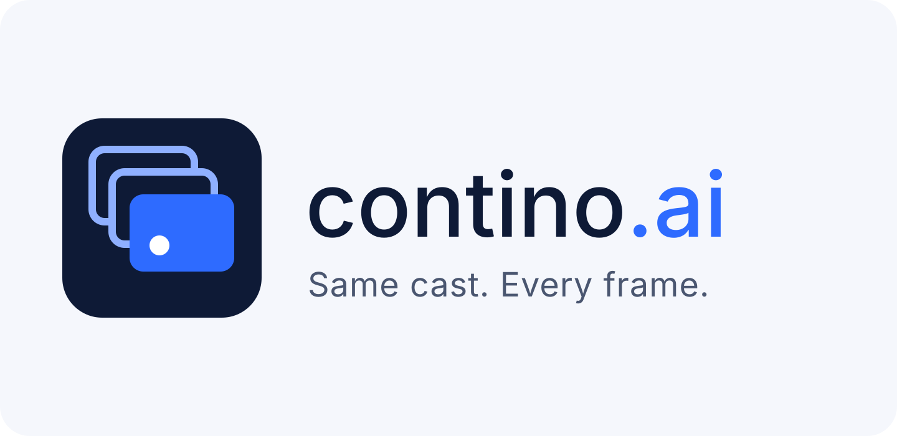

# contino.ai: Same cast. Every frame.



**In one line:** upload a film's shot plan, and contino.ai gives you consistent pictures of every character and place, a reviewed storyboard for each scene, and one finished 16:9 image for every shot. A person approves each step, and every cent spent is logged.

Built for Track 02 (Characters, Locations & Shot Images).

---

## How it works, start to end

### Step 1 · Plan

**You:** upload the Shot Planner PDF, using **+ New project** or the drop area on Home.

**The app:**
- Reads the PDF and finds every **character**, **place**, **scene** and **shot**.
- Shows a "Reading your Shot Planner…" screen while it works, usually under a minute.

**You check:**
- **Scene tabs** (Scene 1 / 2 / 3) list each shot: framing, place, action, dialogue, and who is in it with their feeling.
- **Pencil icon** on a shot: fix it.
- **Click a character or place** to see its picture and edit its name, description and type: person, animal, creature, group (crowd, flock, swarm) or effect (lights, glow, magic).
- **Approve the plan** when it looks right.

### Step 2 · Characters & places

**Goal:** fix the look of everyone and everything, so it stays the same in every shot.

**For each character and place:**
- **Create** draws it from the description, or **Upload** uses your own picture.
- **The AI check** scores each AI-drawn picture out of 100 and lists problems like extra legs or the wrong subject.
  - Your **uploaded** pictures are never scored: they are your decision.
- **Approve**, or:
  - **Change**: type one line, such as "shorter hair", and it redraws.
  - **Start over**: a brand-new picture from the description.

**The type decides how a picture is drawn.** A group becomes a small cluster of its members; an effect becomes the effect alone. A human is only drawn when the description is a human.

**Expressions:**
- After a character's main picture is approved, the app makes one face for each feeling in the story.
- All of one character's faces are drawn together on a single sheet, which is cheaper and keeps the face consistent.
- Expressions are checked only against the main picture, never against the text.

### Step 3 · Storyboard

**You:** click **Sketch scene**. Scene 1 must be approved first, because it fixes the look.

**The app:**
- Draws a quick, cheap sketch for every shot, using the approved character and place pictures.
- The **AI check** scores each shot on six things: characters, image quality (anatomy, hands, props), place, expressions, continuity and framing.
- It lists each real problem with a concrete fix.

**On each shot you can:**
- **Approve it.** A shot passes at 80+ with no serious problems.
- **Fix the serious problems:** one click redraws only that shot, starting from its best version, then checks it again.
- **Describe your own fix** in one line.
- **Click a version chip** (v1 · 87 → v2 · 92) to see older versions, and **use the best one for free**.

**Moving around:**
- **← / →** step through the shots.
- **View board** shows the whole scene as one storyboard image with captions; you can download it.

**When every shot is ready:** **Approve scene**.

### Step 4 · Final images

**You:** click **Make images** for an approved scene.

**The app:**
- Makes one high-quality 16:9 image per shot, from its approved sketch plus the character and place pictures.
- Each image appears as soon as it is ready.

**You:** **Approve** each image, or **Change** it with a one-line note.

### Step 5 · Cost & download

**You see:**
- **Total spent**
- **Cost per approved image**: the main number the judges look at
- **Budget left** out of $50
- **Where the money went**: per step and per shot
- **Every request** in a detailed log

**Downloads:**
- **All outputs (.zip):** character and place pictures, storyboards, final images, review notes and the plan.
- **Cost log (CSV).**

---

## Rules that are always on

| Rule | What it means |
|---|---|
| **You approve every expensive step** | The server blocks skipping ahead, not just the buttons. |
| **No surprise spending** | A low score never redraws on its own; every redraw is your click. |
| **Failed requests retry at most twice** | Then the item is marked **Failed** for you to decide. |
| **Budget guard** | It warns at 80% of $50 and stops new requests at $50. |
| **Changing an approved picture** | Every shot and final that used it is marked **Out of date**. |
| **Projects are separate** | Each has its own data. Delete one from the left panel (trash icon on hover). |

---

## How to run it

**Requirements:** Python 3.12+ and Node 20+.

1. **Add your settings:** copy the example file, then fill in the key and model names.

   ```bash
   cp .env.example .env
   ```

2. **One-time setup:**

   ```bash
   cd api && python3 -m venv .venv && source .venv/bin/activate && pip install -r requirements-dev.txt
   cd ../web && npm install
   ```

3. **Terminal 1: the API** (also runs the background job worker), on http://localhost:8000:

   ```bash
   cd api && source .venv/bin/activate && python -m uvicorn app.main:app --reload --port 8000
   ```

4. **Terminal 2: the web app**, on http://localhost:5173:

   ```bash
   cd web && npm run dev
   ```

5. **Open http://localhost:5173** and drop in `input/Shot-Planner_The-Boy-Who-Cried-Wolf.pdf`.

**Deploying online** (frontend and backend separately, e.g. on Vercel): see **[DEPLOY.md](DEPLOY.md)**.

**Other ways to run it:**
- **Docker:** `docker compose up --build`, then open http://localhost:8080 (web, API and worker).
- **Tests:** from `api/`, with the venv active, run `python -m pytest`. They use a fake OpenAI client, so they cost nothing.

---

## Where keys and models go

All secrets live in `.env`, which is git-ignored. `.env.example` lists every name.

| Variable | What it is |
|---|---|
| `OPENAI_API_KEY` | Your team's OpenAI key (required) |
| `IMAGE_MODEL` | Draws pictures, sketches and finals (e.g. `gpt-image-2.6-sunburst`) |
| `TEXT_MODEL` | Reads the Shot Planner PDF |
| `REVIEW_MODEL` | The vision model that runs the AI check |
| `DATABASE_URL` | PostgreSQL connection string (required) |
| `R2_ACCOUNT_ID`, `R2_ACCESS_KEY_ID`, `R2_SECRET_ACCESS_KEY`, `R2_BUCKET` | Cloudflare R2 bucket for every file (required) |
| `SESSION_SECRET` | Signs the sign-in cookie (required) |
| `API_TOKEN` | Optional team access code, asked for at sign-in |

**Accounts:** everyone signs in with their **email**, which is their user id. Each project belongs to the person who created it and is invisible to everyone else.

**Where data lives:** PostgreSQL holds the `users`, `projects` and `assets` tables, the project data and the job queue. Every file (the input PDF, every picture and its versions, boards, finals, export zips) is stored in a private Cloudflare R2 bucket and listed in the `assets` table with its kind, version, size and checksum.

**At startup:** the app checks every required setting. If any is missing, it stops with a clear message.

**Check everything in one go:** from `api/`, run `python -m app.check`. It tests every setting, the PostgreSQL connection and tables, writing and reading a file in R2, and whether your OpenAI key can use the configured models.

**Tuning:** every other setting (picture sizes, quality levels, review weights and pass mark, prices, budget) is in `config.yaml`.

---

## Quality and cost: what the app does for you

**Same cast in every frame:**
- Every image request includes the approved pictures.
- A sketch gets each character's picture, their expression for that shot, and the place picture.
- A final gets the approved sketch plus the same pictures.

**Prompts that prevent mistakes:**
- Every image prompt has strict rules: the same body as the reference, five fingers, each prop drawn once, nothing floating.
- Captions (shot ID, action, dialogue) are drawn by the app, never by the AI.

**A strict AI check:**

| Score | Weight |
|---|---|
| Characters | 30 |
| Image quality (anatomy, hands, duplicated props) | 20 |
| Place | 15 |
| Expressions | 15 |
| Continuity | 10 |
| Framing | 10 |

- A shot passes at **80+**, with characters and image quality each at least 7.
- Any anatomy mistake caps image quality, so a shot with a mistake can't pass.

**Fixes that improve instead of drifting:**
- Every fix starts from the shot's **best** version and uses that version's own problems.
- It changes only what is listed, and keeps everything else.
- The next check confirms whether the earlier problems were fixed.
- Going back to an earlier version is free.

**Saving money:**

| What | How it saves |
|---|---|
| Sketches | Drawn at low quality |
| Final images | High quality only for approved shots |
| Reference pictures | Shrunk before they are sent to the AI |
| Expressions | All of a character's faces drawn on one sheet |
| Small details | When only small details are left, the app suggests approving, since redrawing rarely raises the score |
| Image requests | Streamed, so slow networks don't drop them |

**Cost log:**
- Every request is logged, including failures and retries, with the real token counts from OpenAI.
- `usage_log.csv` uses the brief's columns: `time, shot_id, step, model, input_tokens, output_tokens, images, gpu_seconds, cost_usd`.
- `usage_by_shot.csv` adds the total per shot and the cost per approved image.

---

## Output folder (Cost → Download, or Save to `output/`)

```
output/<story>/
  library/characters/theo.png      library/reactions/theo_scared.png
  library/locations/hillside-pasture.png
  storyboards/S03_storyboard.png   keyframes/S03_SH03.png
  reviews/S03_review.md            reviews/reviews.json
  plan.json  usage_log.csv  usage_by_shot.csv
```

---

## For developers

```
api/          FastAPI service: approval rules, job queue, storage, OpenAI calls
web/          React + TypeScript app (Vite)
prompts/      Editable prompts in Markdown (review.md is the AI check rules)
config.yaml   Models, sizes, quality, review weights, prices, budget
.env          Secrets and storage mode (git-ignored)
```

**Architecture:**
- **Storage:** one interface with two versions.
  - `local`: JSON files in `data/`, with safe, locked writes.
  - `cloud`: PostgreSQL plus a private Cloudflare R2 bucket.
- **Background jobs:** a durable job queue does all AI work. To scale, add more workers: `python -m app.worker`, or `docker compose up --scale worker=N`. Double-clicks never run a job twice.
- **Budget:** parallel jobs can't overspend it together.
- **Images:** every version is kept and never overwritten.

**API:** interactive docs at http://localhost:8000/docs. Main routes, all under `/api/projects/{id}`:

| Area | Routes |
|---|---|
| Plan | `GET/PUT plan` · `POST plan/approve` |
| Characters & places | `GET library` · `POST library/{item}/generate` · `upload` · `approve` · `reject` · `check` · `POST characters/{id}/reactions/generate` |
| Storyboard | `GET storyboard` · `POST scenes/{scene}/generate` · `POST panels/{shot}/improve` · `fix` · `accept` · `restore` · `POST scenes/{scene}/approve` |
| Final images | `GET finals` · `POST scenes/{scene}/finals` · `POST finals/{shot}/approve` · `reject` |
| Cost & export | `GET usage` · `GET usage.csv` · `POST export` · `GET export.zip` |
| Projects | `GET /api/projects` · `POST /api/projects` (upload) · `DELETE /api/projects/{id}` |
